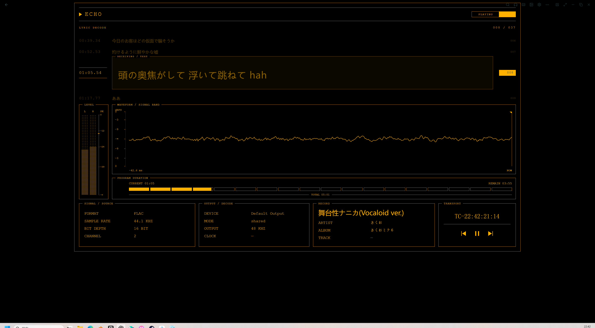

# 回波·终端歌词

把歌词变成正在接收的电报。琥珀色 EL 光线、纯黑底、IBM 3270 数字与拉丁字形，搭配时间戳、分段进度和工业仪表布局。

**[下载 1.0.7](../../downloads/回波·终端歌词-1.0.7.zip?raw=true)** · 最低 ECHO 版本：26.10.16

## 使用

把 ZIP 拖入 ECHO 创意工坊，导入并使用主题，再打开播放器原生歌词页。无需额外按钮、独立插件窗口或前置解码服务。若旧的声明式歌词场景仍生效，先把歌词布局切回 ECHO 内置。

- 歌词按时间戳排列，突出当前句；点击歌词可定位到该句。
- LYRIC DECODE 旁的矩形双语图标切换译文。译文来自 ECHO，主题本身不执行机器翻译。
- 分段进度条支持首次点击定位与连续拖动，右下方提供上一首、播放／暂停、下一首。
- WAVEFORM 右上角切换 FPS MAX、60、30。默认 MAX 跟随屏幕绘制，请求 16 ms 音频更新；实际数据频率由宿主决定。
- 页面随窗口适配，顶部为播放器常驻操作留出空间；右下时间码为本地时间，最后两位为百分之一秒。
- 左上 ECHO 或 Esc 返回播放器。

## 波形与电平

波形使用 ECHO 原生 DSP 后的有符号单声道采样快照，电平使用原生独立声道 RMS，PK 横线表示可用声道中的最大峰值。两者均以数字满刻度为参考；波形的纵向位置是线性振幅，电平柱是 dBFS，因此刻度间距与读数不会简单重合，RMS 也不等于瞬时峰值。

当前接口提供的是短分析窗口，并非整曲前后秒数的预解码轨道。没有有效输入时波形归为直线；缺失的独立声道不补造数据。OUTPUT / DECODE 显示宿主报告的设备、模式、输出采样率与后端。临时缺失时保留同曲最近有效信息，可悬停 DEVICE 查看状态；切歌清空旧值。宿主没有提供的字段显示破折号。

## 预览

以上是用户提供的早期 ECHO 实机截图，未经替换歌词或伪造波形，**不是 1.0.7 的完整验收截图**；当前版已有字体、适配、标签与交互调整。上方头图为原创宣传排版，不是软件截图。音乐、歌词与 ECHO 界面相关权利归各自权利人。

## 开发

本目录 `content/` 即发行源码。编辑后运行 `python package.py` 更新文件清单，并生成仓库 `downloads/` 中的 ZIP。只使用 Python 3 标准库。通过官方 SDK 检查：`node <SDK目录>/bin/echo-workshop-sdk.mjs check <本主题目录>`。

`echo.workshop.project.json` 是工坊作者工程，默认私有且尚未绑定工坊条目。`preview.png` 是 960 × 960 工坊封面；`art/header.png` 是 1920 × 1080 横版头图。公开前请在 ECHO 中确认页面表现。

## 1.0.7

更名为「回波·终端歌词」，保留原内容标识以兼容升级。修复音频元数据先于播放状态到达时丢失、同曲空快照擦除输出信息的问题；将未支持的 CLOCK 项改为真实输出后端 BACKEND。保留内嵌字体、翻译开关、无焦点外框的直接拖动进度和 MAX 刷新模式。

## 许可与素材

原创代码和宣传排版采用 [MIT](LICENSE)。3270 字体来自 [3270font](https://github.com/rbanffy/3270font)，随包保留[原始许可](content/ui/assets/3270-LICENSE.txt)，该字体及其嵌入副本遵循其自身许可。中文、日文使用系统字体回退；不打包音乐或歌词文件。
