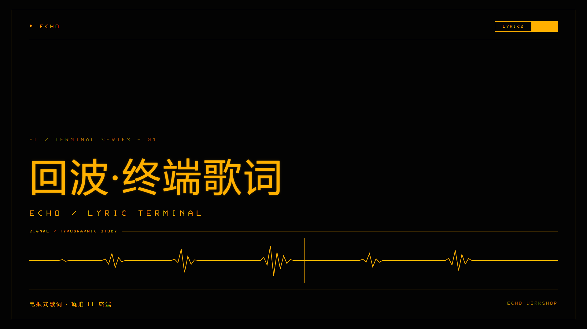
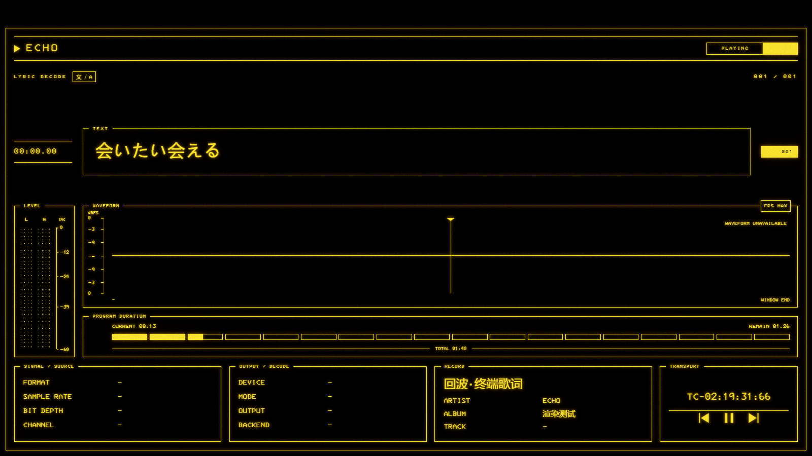
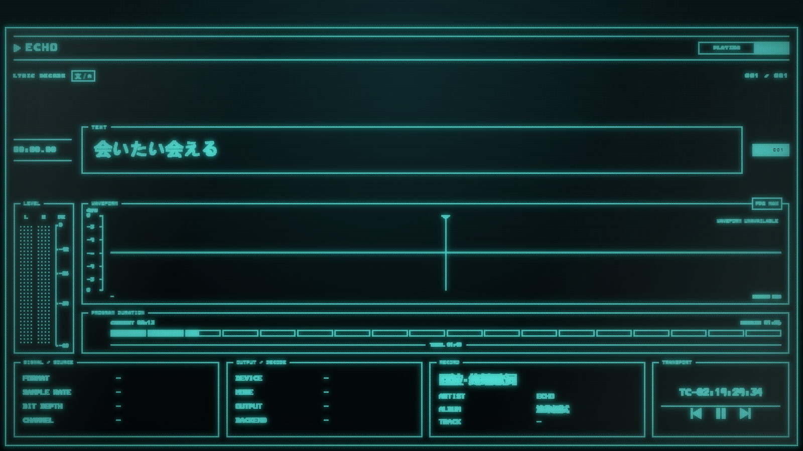
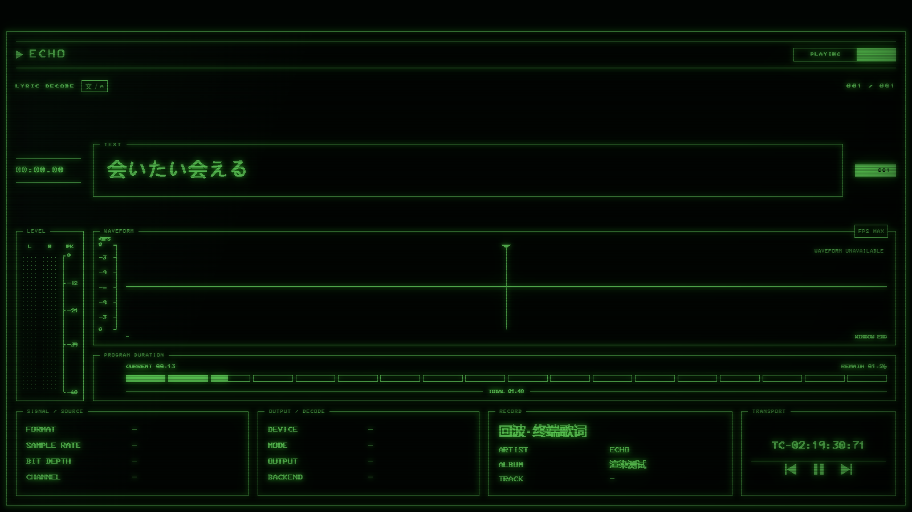

# 回波·终端歌词

把歌词变成正在接收的电报。ECHO 原生 `lyrics-view` 主题，最低 ECHO 26.10.16。

**[下载 1.0.8](../../downloads/回波·终端歌词-1.0.8.zip?raw=true)** · [主题目录](.) · [许可](LICENSE)



## 三种显示材质

- **EL**：琥珀色工业电致发光，清晰核心与暖色光晕；保留 1.0.7 的原始算法。
- **VFD**：青绿/冰青点阵，暗格栅、玻璃反射和独立发光层曝光。
- **CRT**：绿色单色荧光，横向扫描条纹、柔光与暗角。







以上为浏览器模拟宿主中的界面截图，使用演示数据，不是 ECHO 实机验收；实际字体、DPR、缩放和音频输出会影响最终观感。

## 安装

把下载的 ZIP 直接拖入 ECHO 创意工坊，等待验证并导入，然后启用主题并打开原生歌词页。若旧的声明式歌词场景仍生效，先把歌词布局切回 **ECHO 内置**。

1.0.8 保留原内容标识，可在同一主题条目上升级；重新导入 1.0.7 ZIP 即可回滚。主题不会自动打开独立插件窗口，也不会修改 ECHO 安装文件。

## FX 调整

点击状态栏右侧实心区域（可悬停或键盘聚焦）打开 FX 调整。

- 三个按钮：`EL`、`VFD`、`CRT`；默认 EL，只有点击按钮才切换材质。
- 每个模式有独立的下方参数和开关；切换模式不会改动其他模式。
- “恢复默认”只恢复当前模式，不会切回 EL。
- 参数分开保存在 ECHO 主题存储中；默认 EL，重新打开会恢复各模式自己的设置。
- Esc 只关闭 FX 调整，不退出歌词页。

### EL 参数

核心亮度、主体偏黄、贴边光强/半径、暖光强度/半径、外晕强度/半径、边缘颗粒/点距；核心、光晕、边缘颗粒三个开关。EL 的 `display-fx` 算法保持不变。

### VFD 参数

核心亮度、发光层曝光 EV、贴边/中层/远场的强度与半径、玻璃深度、周边格栅增亮、全局格栅可见度、玻璃反射、冰青程度、单元亮度差异、像素点距、单元间隙、细线保留、像素核心对比。玻璃、格栅、光晕、轻微重影四个开关。

1.0.8 的 VFD 默认像素点距为 `1.5`，发光层曝光默认 `2.5`、上限 `3`；其他默认值来自 VFD 指导文件。

### CRT 参数

扫描线间距、扫描线强度、荧光色相、光晕半径、发光亮度。VFD/CRT 是场景级材质滤镜，不是换色：EL 的渲染算法未被修改。

## 数据与限制

- 波形使用 ECHO 原生 DSP 后的有符号单声道采样快照，时间轴是当前短分析窗口，不是整曲预解码轨道。
- 电平使用宿主原生独立声道 RMS；PK 表示可用信道的最大峰值。缺失声道不补造数据。
- VFD/CRT 只改变显示材质，不改变音频输出、DSP、音量或设备。
- 没有有效输入时波形为直线、电平为空；不生成模拟音频。
- 输出设备、模式、采样率和后端以宿主实际上报为准；不支持字段显示 `—`。
- 译文来自 ECHO 提供的歌词，主题不执行机器翻译。

## 1.0.8

- 新增 VFD Hi-Fi 与 CRT Monochrome 两种显示材质；EL 渲染算法保持不变。
- FX 调整按模式显示独立参数、开关和默认值；参数按模式分别记忆。
- VFD 像素点距缩小到 `1.5`，曝光默认 `2.5`、上限 `3`；删除未实现的锐度/局部不均提示。
- 修复网络歌曲自动联播切歌时旧歌词/进度抖动、错误提示残留、框线颜色，以及翻译切换按钮打开后无法关闭。
- 保留 1.0.7 的歌词/进度交互、内嵌 3270 字体、翻译开关和 FPS MAX/60/30。

## 开发与验证

`content/` 是发行源码。编辑后运行 `python package.py` 更新文件清单并生成 `downloads/` 中的 ZIP。通过官方 SDK 检查：

```text
node <SDK目录>/bin/echo-workshop-sdk.mjs check .
```

1.0.8 通过 SDK 1.21.0 质量检查、Node 回归、FX 模式/参数恢复测试和 5 种尺寸浏览器检查。VFD/CRT 在真实 ECHO 中的性能仍需实机确认。

## 许可与素材

原创代码和宣传排版采用 [MIT](LICENSE)。3270 字体来自 [3270font](https://github.com/rbanffy/3270font)，随包保留[原始许可](content/ui/assets/3270-LICENSE.txt)。中文、日文使用系统字体回退；不打包音乐或歌词文件。
