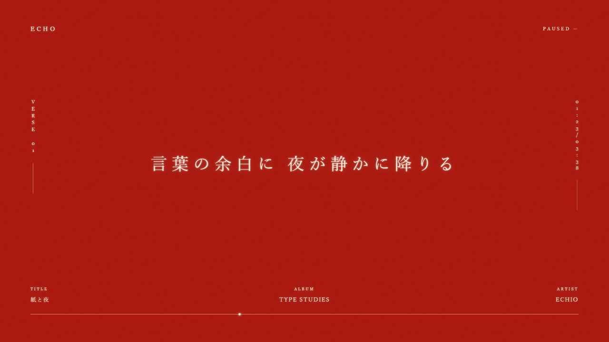
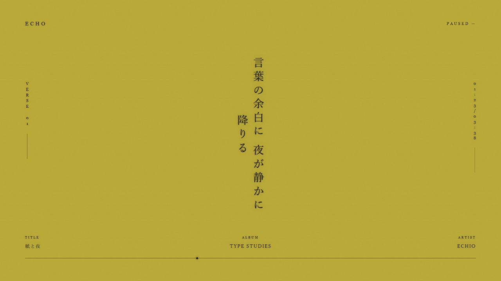
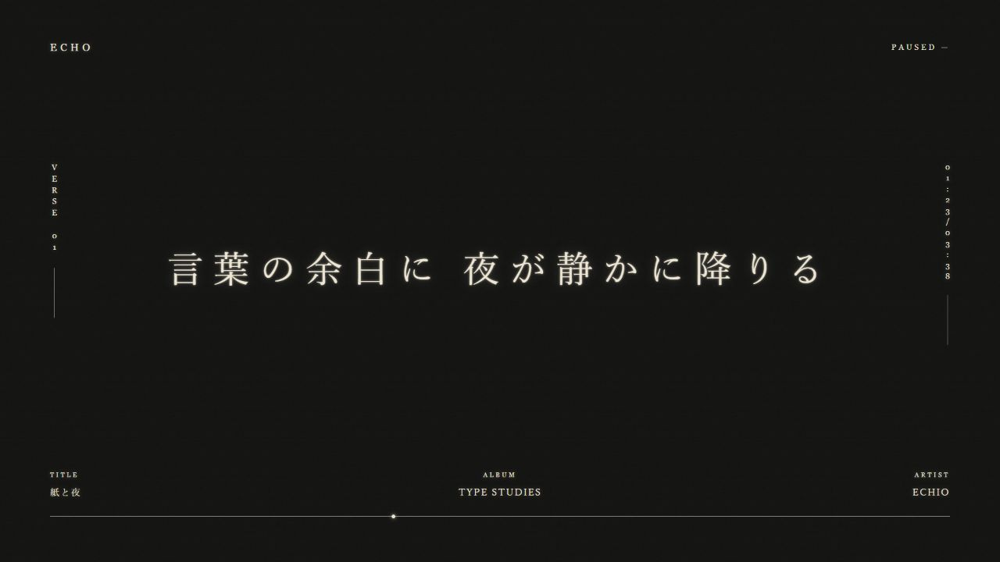
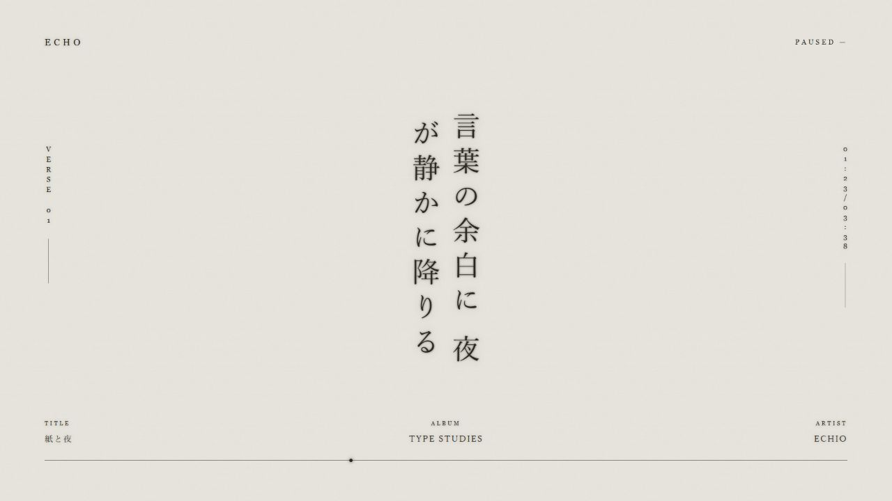

# 余白 · 物语歌词

单句歌词、大留白、宋体／明朝体、轻微辉光与纸纹。提供朱红、芥黄、墨黑、纸白四种配色。

**[下载 1.0.3](../../downloads/monogatari-1.0.3.zip?raw=true)** · 最低 ECHO 版本：26.9.16（需支持 lyrics-view）

## 使用

把 ZIP 拖入 ECHO 创意工坊页面，导入后使用并打开歌词页。顶部中央的菜单可以选择颜色、横竖排、小字译文和字号；也可通过 Tab 访问。四项设置自动保存在 ECHO 的主题存储中，下次打开时恢复，无需手动保存。首次使用默认朱红、横排、36 px、关闭译文。

- 右上角：暂停／继续。
- 底部进度线：定位；点击当前歌词：回到本句开头。
- 译文：横排在原文上方，竖排在右侧，使用同一颜色；按整句旁注，不假造逐词对应。
- 无同步歌词：显示可滚动的纯文本；无歌词、前奏、纯音乐有独立状态。

若旧的声明式歌词场景仍然生效，请先将歌词布局切回 ECHO 内置。此前本地试用包使用旧标识；本仓库统一使用 `echio.monogatari-lyrics`，如果同时出现两个余白主题，选择本仓库导入的条目并停用旧条目。

## 预览

截图来自实际主题代码与模拟宿主，文案为原创演示。无需音乐、联网或系统权限。

## 开发

编辑 `content/ui/`。从仓库根目录运行 `python tools/package.py monogatari` 更新清单并打包（Python 3 标准库即可）。生产校验使用 [官方 SDK](https://github.com/Moekotori/echo-workshop-sdk)：`node <SDK目录>/bin/echo-workshop-sdk.mjs check themes/monogatari`。

## 1.0.3

新增外观记忆：配色、横竖排、字号和译文开关自动保存与恢复。声明官方 `storage` 能力；重新打开页面后继续使用上次的设置。

## 1.0.2

采纳社区提供的 1.0.2 包中的主动索词方案：宿主未推送歌词时，通过 `lyrics:get` 读取当前曲；请求绑定歌曲及本次播放，避免切歌后旧请求串词。保留宿主后续歌词更新和纯音乐状态。本次未纳入依赖第三方 Loader Mod 的 MV 透底扩展。

回归检查：仓库根目录运行 `node tools/runtime.test.mjs`。

## 1.0.1

修复相同歌词文档重复发布时触发闪烁；专用时钟停滞时回退到宿主普通播放进度；译文改为随原文方向变化的小字旁注。已完成 SDK 校验与模拟宿主回归测试，实际歌曲兼容性仍欢迎反馈。

## 许可与素材

遵循仓库 MIT 许可。纹理由程序生成，使用系统宋体／明朝体回退，不捆绑字体文件、音乐、动画截图或第三方歌词。运行时只显示 ECHO 提供的当前曲歌词。视觉风格受到物语系列文字排版启发，本项目并非其官方作品。
